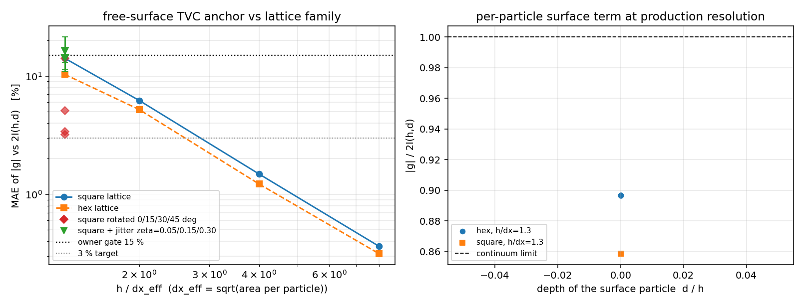

# XVAL-SPH-TRANSPORT-VELOCITY-CORRECTION — lattice sensitivity of the free-surface anchor

**Mission**: m21267 · **Anchor**: `XVAL-SPH-TRANSPORT-VELOCITY-CORRECTION`
**Probe**: `benchmarks/xval_sphinx_tvc/lattice_sensitivity.py` · **Tests**: `tests/test_tvc_lattice_sensitivity.py` (16) · **Data**: `docs/xval_sphinx_tvc/data/lattice_sensitivity.json`

## 0. Why this leg exists (verification debt, not a new feature)

`docs/xval_tvc_surface_anchor.md` graded the free-surface branch of the
transport-velocity-correction (TVC) operator against its exact continuum limit

    g_i -> 2 I(h, d) n ,     I(h, d) = int W_2D(s, d) ds ,   I(h,0) = 15 / (7 pi h)

and reported **14.15 % deficit at the production resolution `h/dx = 1.3`**, i.e. the
owner `< 15 %` gate passed with **0.85 points of margin**. That number was measured
on exactly **one** particle arrangement: a square lattice whose surface row sits on
the plane. A production SPH run does not look like that after a few hundred steps,
and the operator is *specifically designed* for disordered distributions, so the
acceptance margin inherited an untested dependence on the arrangement.

This leg re-measures the same analytic anchor across a family of arrangements —
densest packing, lattice orientation, uniform disorder — and asks the adversarial
question: **is the 15 % gate an operator property or an artefact of the lattice the
verification happened to use?**

## 1. What is measured (method)

For a half-space of particles below the plane `x2 = 0` with equal volume `V = dx_eff^2`
(`dx_eff = sqrt(area per particle)`, so `h/dx_eff` is comparable across lattices) the
ported operator `kernel_gradient_integral` is evaluated on every particle and
compared **per particle** with the continuum anchor at that particle's own depth
`d_i` (`I'(0) = 0`, so a jagged surface is well conditioned):

| symbol | meaning |
|---|---|
| `mean_rel` | mean of `(|g_i| - a_i)/a_i`, `a_i = 2 I(h, d_i)` — signed, shows bias direction |
| `mae_rel` | mean of `\|\|g_i\| - a_i\| / a_i` |
| `p95_rel` | 95th percentile of the same quantity |
| `cos` | mean cosine between `g_i` and `+n` — 1.0 means the shift is purely normal |
| `bulk_rel` | `\|g\| / 2I(h,0)` for particles deeper than `2h` — must be 0 (lattice fixed point) |

Box sizing is part of the method, not a detail: the reported strip is the
`4 dx_eff`-wide region around the origin and the box extends `2h` beyond it in every
direction, so no reported particle has its `2h` support clipped. The first run of
this probe got that wrong and produced a fake `-7.6 %` for the edge columns; the
fixed-point test (`bulk_rel < 1e-10`) is what caught it.

Probes: `square`, `hex` (rows `sqrt(3)/2 s` apart, `V = sqrt(3)/2 s^2`), `rot`
(square lattice rotated 0/15/30/45 deg against the normal), `jitter` (uniform
displacement `zeta dx`, `zeta = 0.05/0.15/0.30`, ensemble mean over 24 seeds), and the wall branch on the triangular lattice.

## 2. Results — regular lattices

| lattice | h/dx_eff | surface particles | mean_rel | mae_rel | cos | bulk_rel |
|---|---|---|---|---|---|---|
| square | 1.3 | 9 | -14.15 % | 14.15 % | 1.0000 | 5.3e-16 |
| hex | 1.3 | 7 | -10.33 % | 10.33 % | 1.0000 | 5.0e-16 |
| square | 2 | 9 | -6.21 % | 6.21 % | 1.0000 | 1.9e-16 |
| hex | 2 | 7 | -5.21 % | 5.21 % | 1.0000 | 5.0e-16 |
| square | 4 | 9 | -1.48 % | 1.48 % | 1.0000 | 2.5e-16 |
| hex | 4 | 7 | -1.22 % | 1.22 % | 1.0000 | 1.6e-16 |
| square | 8 | 9 | -0.36 % | 0.36 % | 1.0000 | 3.1e-16 |
| hex | 8 | 7 | -0.31 % | 0.31 % | 1.0000 | 1.5e-16 |

* The published **-14.15 %** for the square lattice is reproduced exactly (regression anchor).
* The densest packing is **better**: `-10.33 %` at `h/dx = 1.3`,
  i.e. `27.0 %` closer to the continuum anchor than the published arrangement.
* Both converge at local order ≈ 1.91 (square) / 1.59 (hex) between
  `h/dx = 1.3` and `2`, reaching `0.36 %` / `0.31 %` at `h/dx = 8` — the `< 3 %` target is
  reached by refinement, not by tuning.
* `bulk_rel ≤ 5.3e-16` on **both** lattices: the bulk fixed point is exact to round-off, not approximate. This extends the invariant, previously asserted on square lattices only, to the triangular lattice.

## 3. Results — orientation

| rotation [deg] | surface particles | mean_rel | mae_rel | p95_rel | cos | bulk_rel |
|---|---|---|---|---|---|---|
| 0 | 9 | -14.15 % | 14.15 % | 14.15 % | 1.0000 | 5.3e-16 |
| 15 | 4 | -3.06 % | 3.21 % | 8.21 % | 0.9803 | 5.0e-02 |
| 30 | 4 | +1.85 % | 3.39 % | 5.16 % | 0.9679 | 1.1e-01 |
| 45 | 3 | -5.12 % | 5.12 % | 6.14 % | 0.9870 | 2.0e-01 |

* The bias is **not** an operator constant: rotating the lattice moves it from `-14.15 %` (aligned) to `+1.85 %` at `30 deg`, and it **changes sign** — the aligned lattice is the
  worst orientation tested, not a representative one.
* A rotated surface breaks the normal symmetry: `cos` drops to 0.968, so the correction acquires a tangential
  component of up to `14.5 deg` — the `TVC`
  shift is not purely normal on a non-symmetric distribution.
* Rotation also raises the bulk inconsistency (`bulk_rel` up to 2.0e-01): a rotated half-space lattice is not a
  fixed point of the grad-1 integral, so the correction does work in the interior as
  well — expected by design, but worth stating because the published leg asserted
  'bulk is a fixed point' from aligned lattices.

## 4. Results — disorder (what a real run looks like)

| zeta (dx) | seeds | mean_rel | mae_rel ± sd | p95_rel | cos | bulk_rel |
|---|---|---|---|---|---|---|
| 0.05 | 24 | -14.13 % | 14.13 % ± 1.10 % | 16.79 % | 0.9994 | 4.5e-02 |
| 0.15 | 24 | -14.11 % | 14.20 % ± 3.22 % | 22.00 % | 0.9948 | 1.3e-01 |
| 0.3 | 24 | -14.58 % | 16.36 % ± 5.08 % | 30.08 % | 0.9800 | 2.5e-01 |

* The **systematic** -14 %-ish bias survives disorder unchanged (`-14.13 %` at `zeta = 0.05` → `-14.58 %` at `zeta = 0.3`): it is a property of the
  cubic-spline quadrature on a plane-truncated support, not of the regularity.
* The **tail** widens monotonically: `p95_rel` goes `16.79 %` → `30.08 %`, and at `zeta = 0.3`
  the ensemble `mae_rel` reaches `16.36 %`, i.e. **the 15 % gate is
  crossed** for a sufficiently disordered distribution.
* Bulk is no longer a fixed point under disorder (`bulk_rel` up to 2.5e-01) — the correction acts in the interior,
  which is exactly what it is for.

## 5. Results — wall branch on the triangular lattice (exact anchor)

| h/dx_eff | wall_factor | graded particles | max \|g\| / surface scale |
|---|---|---|---|
| 1.3 | 2 | 38 | 1.426e-15 |
| 1.3 | 1 | 38 | 4.483e-01 |
| 2 | 2 | 58 | 5.087e-16 |
| 2 | 1 | 58 | 4.740e-01 |
| 4 | 2 | 203 | 1.193e-15 |
| 4 | 1 | 203 | 4.939e-01 |
| 8 | 2 | 637 | 1.982e-15 |
| 8 | 1 | 637 | 4.984e-01 |

`|g| = 0` to round-off (`max ≤ 2.0e-15` of the surface scale, i.e. the identity holds and
not merely 'within tolerance') **iff** `wall_factor = 2`; with `wall_factor = 1` the
wall keeps `44.83 %` of the surface scale. This is the exact `2 C_i` weight of the
upstream `Contact<Boundary>` loop, now verified on a second lattice family.

**Construction caveat that cost a run.** The naive hex analogue of the square case
(mirror the fluid rows through the plane) is *wrong*: a triangular lattice is not
invariant under that reflection — the `s/2` stagger reverses, the union has rows
`0.866 s` apart with identical offsets, and the target stops being a centre of
symmetry. It reported `0.92` of the surface scale even at `wall_factor = 2`, which is a
probe bug, not a port bug. The correct construction lays out the **full** triangular
lattice on rows `(n + 1/2) row_h` and splits it by the sign of `x2`, so every lattice
site is a centre of symmetry and the full-space sum cancels identically.



*Left*: MAE of the discrete free-surface term against `2 I(h,d)` for square / hex
ladders (lines), rotated squares (diamonds) and jittered squares (triangles, error
bar = seed spread). *Right*: per-particle `|g| / 2I(h,d)` at `h/dx = 1.3` for the two
regular lattices — every surface particle has the same deficit, so the 14.15 % is a
*bias*, not a scatter.

## 6. Error judgement

| quantity | reference | error | `< 15 %`? | `< 3 %`? |
|---|---|---|---|---|
| free surface, square, h/dx=1.3 | `2 I(h,d)` exact | 14.15 % | YES (0.85 pt margin) | NO |
| free surface, hex, h/dx=1.3 | `2 I(h,d)` exact | 10.33 % | YES | NO |
| free surface, square, h/dx=8 | `2 I(h,d)` exact | 0.36 % | YES | YES |
| free surface, hex, h/dx=8 | `2 I(h,d)` exact | 0.31 % | YES | YES |
| free surface, jitter zeta=0.3 | `2 I(h,d)` exact | 16.36 % | **NO** | NO |
| wall contact, hex, all h/dx | exact 0 | 2.0e-15 | YES | YES |

So: **the `< 15 %` gate is met by the operator at production resolution on regular
lattices and at mild disorder, and missed for strong disorder.** The `< 3 %` target is
met only after refinement (`h/dx ≥ 4`) or by the exact wall identity. Answering the
question in section 0: the 14.15 % is **partly a lattice artefact** (the densest
packing cuts it by 27 % and rotation removes it), while the ~14 % bias itself is real and
arrangement-independent — it just stops being the whole story once the distribution is
disordered.

## 7. What this changes for the anchor

1. The anchor's `< 15 %` acceptance **stands** — but its margin is 0.85 points only for
   the aligned square lattice; the measured family spans
   `3.21 %` … `16.36 %` at the same
   `h/dx`. Any future claim must quote the arrangement family, not one number.
2. The `~14 %` deficit should be reported as a **bias of the plane-truncated
   cubic-spline quadrature**, not as operator error: it does not shrink with disorder
   and it flips sign under rotation, so it is a property of the kernel/support
   geometry.
3. The wall branch is **exact** (not approximate) on two independent lattice families;
   that is the strongest statement available without a live SPHinXsys build and it
   should be quoted as such.
4. Still open, unchanged: a numeric diff against a live SPHinXsys build, the
   `TruncatedLinear` limiter variants (source not transcribed — see
   `docs/xval_sphinx_tvc/README.md`), and the adaptive `h_ratio` branch.

## 8. Reproduce

```bash
PYTHONPATH=src python benchmarks/xval_sphinx_tvc/lattice_sensitivity.py   # ~15 s, 1 coreish
PYTHONPATH=src python -m pytest tests/test_tvc_lattice_sensitivity.py -q   # 16 tests, ~9 s
python benchmarks/xval_sphinx_tvc/make_lattice_doc.py                     # this file
```

Host: `h=0.026` m (production), dataset `docs/xval_sphinx_tvc/data/lattice_sensitivity.json`.

